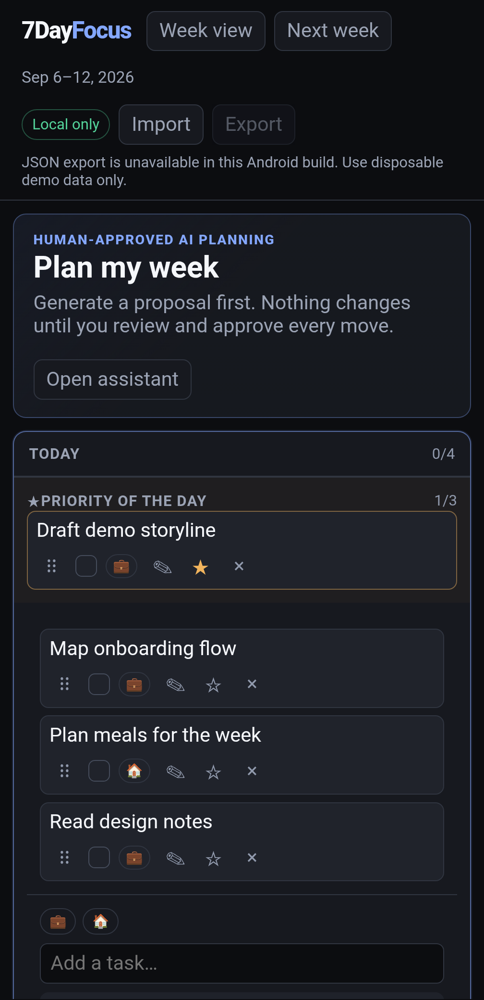

# 7DayFocus AI Delivery Lab

A seven-day planner for web and Android. Organize Work and Life tasks, set daily priorities, and review proposed changes before applying them.

I used this project to improve my 7DayFocus app and learn AI-assisted software delivery. The repository keeps the working planner, engineering decisions, tests and Android findings available to inspect. It is a personal learning project, not a production service.

<a id="run-the-fictional-demo"></a>

## Try the planner with sample tasks

The app is real; this walkthrough uses sample tasks and a deterministic offline proposal. You need Git, npm and Node.js 24.19.0, selected by `.nvmrc`. With nvm installed:

```sh
git clone https://github.com/Andreasniss/7dayfocus-ai-delivery-lab.git
cd 7dayfocus-ai-delivery-lab
nvm use
npm ci
npm run verify
npm run dev
```

1. Open the Vite URL and choose **Import**.
2. Select [examples/demo-week.json](examples/demo-week.json). Import replaces local data: confirm only if that data is disposable or backed up.
3. Open **Plan my week**, keep **Fixture demo**, and generate a proposal.
4. Review the proposed move of **Map onboarding flow** from Sunday to Saturday, then select **Approve all changes**.

Expected result: no tasks change during generation; one validated move is applied after approval. Fixture mode needs no account or API key and makes no model request. [Full walkthrough](examples/README.md).

## See the app



An actual Pixel 8 Pro capture using fictional sample tasks. [More screenshots and capture provenance](docs/screenshots/README.md).

## How suggestions work

The assistant can propose moves and priority changes for existing incomplete tasks. It cannot create, rewrite, delete or complete tasks. The app validates the full proposal, rejects it if your plan has changed, and applies it only after approval.

Optional live providers are available in local web development through a loopback gateway. Use your own key and non-sensitive fictional data; provider policies and billing apply. [Provider setup and boundaries](GUIDE.md#bring-your-own-provider-key).

## Android and data limits

The Android build was installed and tested on a Pixel 8 Pro running Android 17. The [device evidence](docs/ai-dlc/changes/P11-android-personal-install/evidence.md) records that revision, fixes and limitations; it does not verify later revisions.

- Android supports the offline fixture only, not live providers.
- Android JSON import was verified. Export is disabled because the tested download path did not produce a file. Use disposable sample data there.
- Tasks stay as plaintext JSON in the browser profile or Android WebView. There are no accounts, cloud sync or analytics. Concurrent tabs use last-write-wins.
- Google Play availability and release signing are not claimed.

See the [Android runbook](docs/ANDROID.md) before building or installing.

## Inspect the engineering

- [Project guide](GUIDE.md): product history, architecture, evidence and limitations.
- [Plan My Week change](docs/ai-dlc/changes/P04-plan-my-week/): intent, specification, implementation plan and checks.
- [Evaluation cases](evals/README.md): deterministic proposal checks, not a live-model benchmark.
- [Threat model](docs/THREAT-MODEL.md): credentials, data and trust boundaries.
- [Case study](https://andreasnissen.dev/projects/7dayfocus-ai-delivery-lab/): the app and lessons learned.

Standalone-product development has stopped; the app remains an inspectable learning project. The [product history](GUIDE.md#what-changed-after-the-prototype) explains that decision. Possible learning extensions live in [ROADMAP.md](ROADMAP.md).

## Contribute and reuse

Follow [AGENTS.md](AGENTS.md), [REVIEW.md](REVIEW.md) and [PRIVACY.md](PRIVACY.md). `npm run verify` is the local verification gate. The [delivery records](docs/ai-dlc/README.md) distinguish public source guidance from this project's conventions.

Built by [Andreas Nissen](https://andreasnissen.dev), with AI assistance. Andreas owns product, architecture, evaluation, risk and release decisions. [AI assistance and attribution](GUIDE.md#ai-assisted-delivery-disclosure). This independent project implies no employer or provider endorsement.

Copyright 2026 Andreas Nissen. Original code and technical documentation: [Apache-2.0](LICENSE), except where indicated. See [NOTICE](NOTICE); third-party material retains its own terms.
